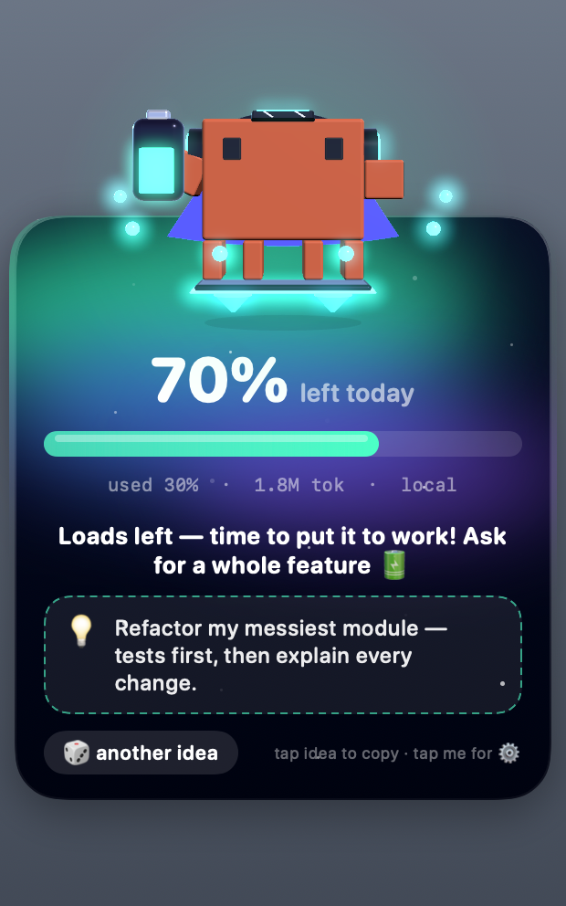
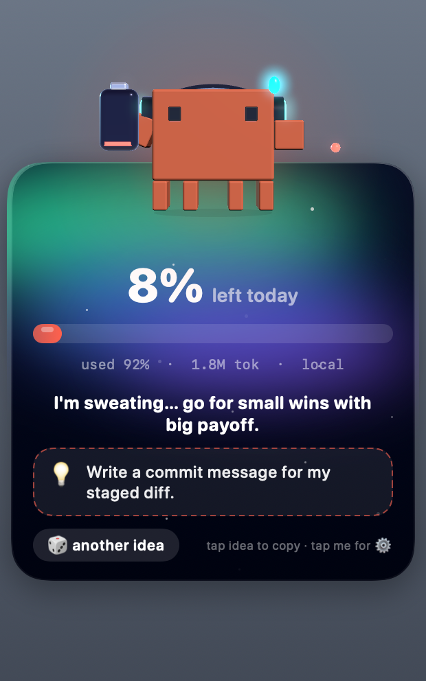
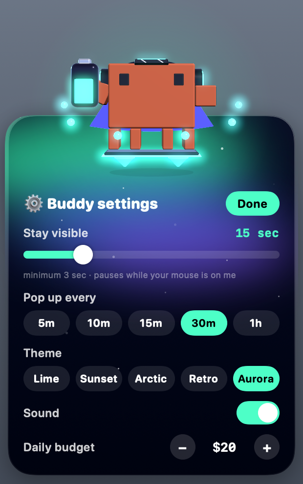
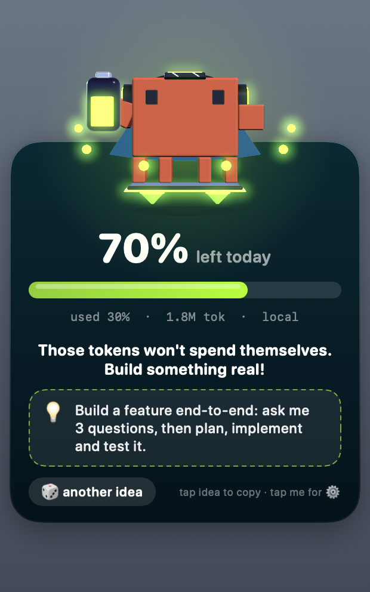
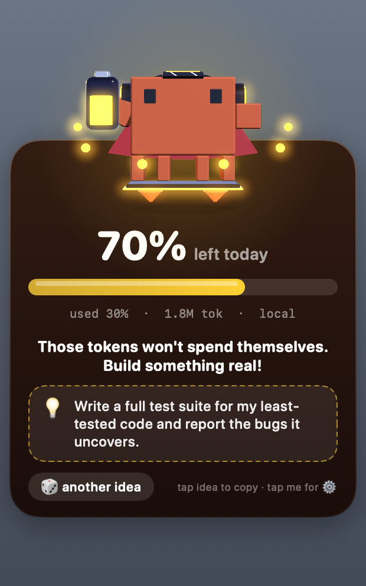
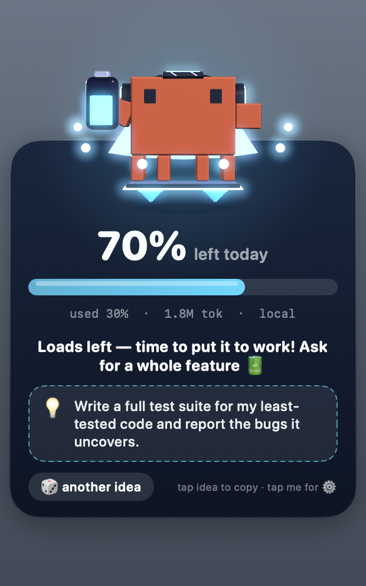
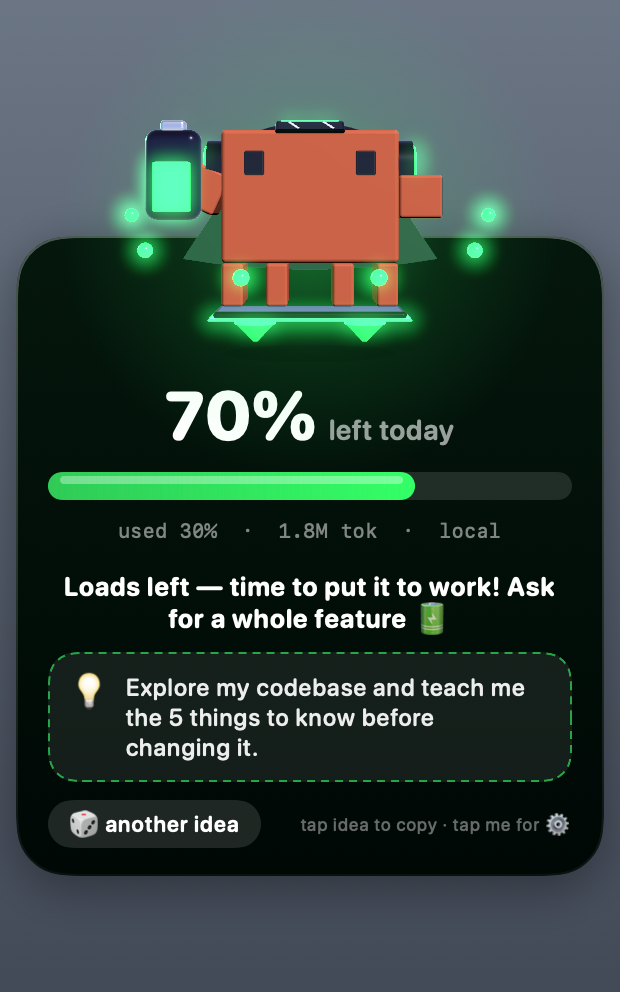

# ClaudeBuddy 🍌

A small macOS menu-bar companion for [Claude Code](https://claude.com/claude-code) users. Every so often a little 3D robot walks onto your screen, tells you how much of your daily budget you have left, and nudges you with a prompt idea to put the rest to work.

<p align="center">
  
  
  
</p>

> **Unofficial project.** ClaudeBuddy is a community project. It is not affiliated with, endorsed by, or sponsored by Anthropic. "Claude" is a trademark of Anthropic.

## Contents

- [Features](#features)
- [Requirements](#requirements)
- [Install](#install)
- [Using ClaudeBuddy](#using-claudebuddy)
- [Configuration](#configuration)
- [Themes](#themes)
- [How the numbers work](#how-the-numbers-work)
- [Privacy and security](#privacy-and-security)
- [Troubleshooting](#troubleshooting)
- [Limitations](#limitations)
- [Development](#development)
- [Project layout](#project-layout)
- [Contributing](#contributing)
- [License](#license)

## Features

- Shows today's budget used and left, token count, and a progress bar.
- Pops up on a timer (default every 30 minutes), walks in from a screen edge, and walks out again.
- Suggests a prompt idea matched to how much budget you have left. Click it to copy.
- Five themes, a settings panel, optional sound.
- Runs from the menu bar (no Dock icon) and can start at login.
- Works fully offline from your local Claude Code logs. An optional Admin API key gives real spend.

## Requirements

- macOS 13 (Ventura) or later
- Swift 5.9+ toolchain: Xcode, or the Command Line Tools (`xcode-select --install`)
- Claude Code usage on this machine (the app reads its local logs)

## Install

```bash
git clone <REPO_URL> ClaudeBuddy
cd ClaudeBuddy
./install.sh
```

`install.sh` will:

1. Build a release binary with `swift build -c release`.
2. Create `~/Applications/ClaudeBuddy.app` (ad-hoc signed, not notarized).
3. Register a LaunchAgent (`com.claudebuddy.agent`) so it starts at every login.
4. Start it. Look for 🍌 in the menu bar.

To remove everything:

```bash
./uninstall.sh
```

This deletes the app and the login item. Your settings in `~/.claude-buddy` are kept.

To try it without installing: `swift run ClaudeBuddy`.

## Using ClaudeBuddy

**Menu bar (🍌)**

| Item | Shortcut | What it does |
| --- | --- | --- |
| Show now | `S` | Pops the buddy up immediately with fresh numbers |
| Hide | `H` | Sends the buddy away |
| Edit config file… | `,` | Opens `~/.claude-buddy/config.json` |
| Quit | `Q` | Stops the app until your next login |

**On the card**

- **Click the idea box** to copy the suggested prompt to your clipboard, then paste it into Claude Code.
- **🎲 another idea** picks a different prompt.
- **Click the robot** to open settings: how long it stays visible, how often it appears, theme, sound, and daily budget.
- **Hover** over the card to keep it on screen (it even turns back if it is already leaving). After you move the mouse away it stays for at least 8 more seconds.

The message and prompt change with your remaining budget, from "over 80% unused" through "running on fumes" down to "budget eaten", and big-project prompts give way to small, high-value ones as the tank empties.

## Configuration

Use the in-app settings panel, or edit `~/.claude-buddy/config.json` (created on first run). Restart the app after hand-editing, for example with the menu's Quit and then reopening it.

```json
{
  "corner": "bottomRight",
  "dailyBudgetUSD": 20,
  "intervalMinutes": 30,
  "visibleSeconds": 15,
  "sound": true,
  "theme": "Aurora"
}
```

| Key | Default | Meaning |
| --- | --- | --- |
| `dailyBudgetUSD` | `20` | Your daily budget in USD. The gauge is spend divided by this. |
| `intervalMinutes` | `30` | Minutes between automatic pop-ups |
| `visibleSeconds` | `15` | Seconds the card stays after the buddy arrives (minimum 3) |
| `corner` | `bottomRight` | `bottomRight`, `bottomLeft`, `topRight`, or `topLeft` |
| `sound` | `true` | Play sound effects |
| `theme` | `Aurora` | One of the [themes](#themes) below |

Missing or invalid keys fall back to the defaults.

## Themes

| Lime | Sunset | Arctic | Retro | Aurora |
| :---: | :---: | :---: | :---: | :---: |
|  |  |  |  |  |

Aurora has an animated northern-lights background. Set the theme in the settings panel or with `"theme"` in the config.

## How the numbers work

ClaudeBuddy has two sources, and the card tells you which one it is using (`local` or `API`).

**Local estimate (default, no setup).** It reads today's usage records from `~/.claude/projects/**/*.jsonl` (written by Claude Code), de-duplicates them, and multiplies token counts by built-in per-model prices (USD per million tokens, input / output):

| Model family | Input | Output |
| --- | --- | --- |
| Haiku | $1 | $5 |
| Sonnet | $3 | $15 |
| Opus and anything else | $15 | $75 |

Cache writes are priced at 1.25x input and cache reads at 0.1x input. These are **estimates**. If Anthropic's pricing differs, edit `UsageReader.price` in `Sources/ClaudeBuddy/Usage.swift`.

**Real spend (optional).** If an Anthropic **Admin** API key is available, ClaudeBuddy asks the Admin cost report for today's actual spend (UTC day) and shows that instead. Admin keys are an organization feature and are different from normal API keys, so this may not be available to individual accounts. Provide it in one of two ways:

```bash
# Option 1 (recommended): macOS Keychain
security add-generic-password -s claude-buddy-admin-key -a "$USER" -w
# (you will be prompted for the key)

# Option 2: environment variable (note: a LaunchAgent does not inherit your shell
# environment, so this mainly helps when running with `swift run`)
export ANTHROPIC_ADMIN_KEY=...
```

If the key is missing or the request fails, the app silently falls back to the local estimate.

## Privacy and security

- Local usage is computed on your machine. Nothing from `~/.claude/projects` is uploaded or logged.
- The **only** network request is an HTTPS call to `api.anthropic.com` for the optional cost report, and only if you provide an Admin key.
- The key is kept in memory only. The app never writes it to disk or logs it, and it is never part of this repository.
- The installer ad-hoc signs the app. It is not notarized, so only build from source you trust.

To report a vulnerability, see [SECURITY.md](SECURITY.md).

## Troubleshooting

| Problem | Try |
| --- | --- |
| No 🍌 in the menu bar | Check it is running: `launchctl print gui/$(id -u)/com.claudebuddy.agent`. Reinstall with `./install.sh`. |
| Menu item gone after "Quit" | Quit stops it until next login. Relaunch with `open ~/Applications/ClaudeBuddy.app`. |
| Build fails | Make sure `swift --version` is 5.9 or newer and Xcode/CLT is installed. |
| Shows 0 tokens / $0 | Claude Code has not been used today on this Mac, or its logs are not in `~/.claude/projects`. |
| Numbers differ from my bill | The local mode is an estimate. Use an Admin key for real spend. |
| Config change ignored | Quit and relaunch the app after editing the file by hand. |
| Need logs | `~/.claude-buddy/buddy.log` |

## Limitations

- macOS only (uses AppKit, SceneKit, and the macOS Keychain).
- Local mode covers Claude Code logs only, not usage from other tools or the Claude web app.
- Prices are hardcoded estimates and unknown models are billed at Opus rates.
- Real-spend mode needs an Admin key, which not every account can create.
- "Daily" means your local calendar day for the local estimate and the UTC day for the API figure, so the two can differ near midnight.

## Development

```bash
swift build                 # debug build
swift run ClaudeBuddy       # run from the terminal
swift build -c release      # release build
```

Enable the secret-scanning pre-commit hook once after cloning:

```bash
git config core.hooksPath .githooks
```

Render a preview image without launching the UI (this is how the screenshots above were made):

```bash
ClaudeBuddy --snapshot out.png 0.3                   # 30% of budget used
ClaudeBuddy --snapshot out.png 0.92 --theme Retro    # nearly out, Retro theme
ClaudeBuddy --snapshot out.png 0.3 --settings        # settings panel
```

## Project layout

```
Package.swift                    Swift package (single executable target, macOS 13+)
install.sh / uninstall.sh        Build + install as a login item / remove it
Sources/ClaudeBuddy/
  main.swift                     App entry, menu bar, floating panel, SwiftUI card + settings, --snapshot
  BuddyScene.swift               The 3D robot (SceneKit): model, animations, accessories
  Theme.swift                    Colour themes
  Usage.swift                    Config file, local log parsing, Admin cost report, Keychain lookup
  Banter.swift                   Messages and prompt ideas by remaining budget
  Sound.swift                    Sound effects
docs/images/                     README screenshots
.github/                         CI, issue/PR templates, Dependabot
.githooks/pre-commit             Blocks commits that contain API keys or private keys
```

## Contributing

Issues and pull requests are welcome. Please read [CONTRIBUTING.md](CONTRIBUTING.md) and the [Code of Conduct](CODE_OF_CONDUCT.md) first.

## License

[MIT](LICENSE)
